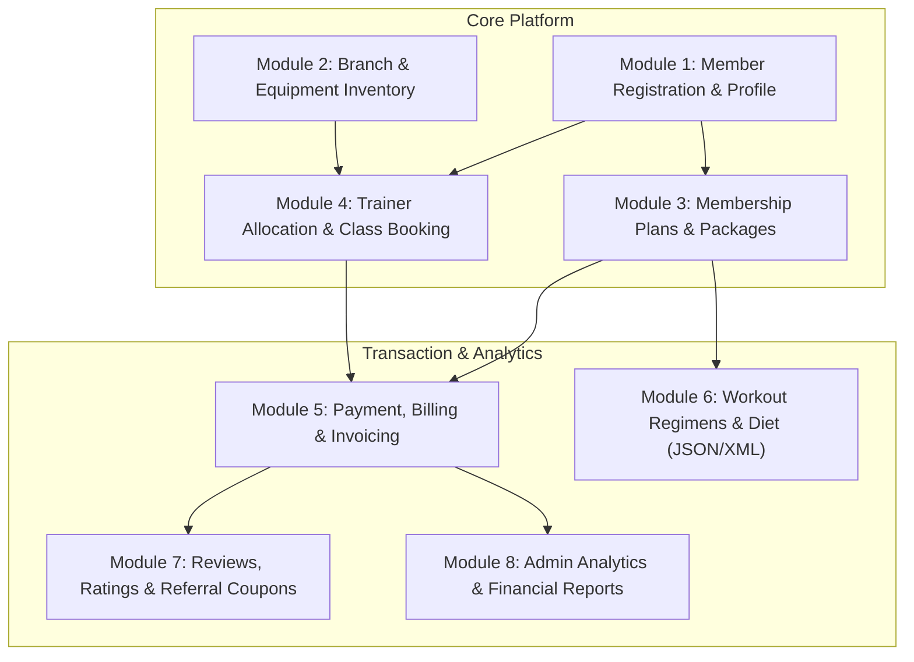

# FitTrack: Smart Gym Management System
## Deliverable 1: Problem Definition, Project Objectives & System Architecture

### 1. Problem Statement
Modern fitness centers and multi-branch gym chains face operational and analytical bottlenecks. Traditional gym management relies on fragmented paper registers, disparate spreadsheets, and disconnected third-party POS machines. These disconnected systems lead to:
1. **Inefficient Member Onboarding & Profile Tracking**: Inability to seamlessly maintain member health metrics (BMI, cardiovascular stats, dietary restrictions), active subscriptions, and emergency contact details across gym branches.
2. **Branch & Equipment Inventory Discrepancies**: Uncoordinated inventory of strength/cardio machines, lack of preventive maintenance tracking, and unsynchronized equipment distribution across city centers.
3. **Class Scheduling & Capacity Overbooking**: Chaotic booking workflows for specialized group workouts (CrossFit, Zumba, Pilates, Yoga) causing class overcrowding, trainer allocation clashes, and no waitlist controls.
4. **Subscription, Billing & Refund Inconsistencies**: Financial transaction errors during plan renewal, proration calculations for mid-cycle upgrades, coupon validation failures, and uncoordinated refund processing.
5. **Lack of Advanced Analytics & Semi-Structured Data Storage**: Relational tables struggle to store diverse workout regimens, customizable macronutrient diet charts, and multi-sensor wearable telemetry.

**FitTrack** solves this by establishing an enterprise-grade, Advanced Database Management System (ADBMS) tailored for smart gym chains. FitTrack unites members, personal trainers, branch administrators, and equipment vendors into a unified, transactionally sound, and analytically powerful database-backed web application.

---

### 2. Project Objectives
- **Centralized Multi-Branch Operations**: Deliver an extensible schema supporting multiple gym branches with independent equipment inventories and trainer schedules.
- **Robust Transaction Management (ACID Compliance)**: Guarantee strict consistency during member enrollment, slot bookings, coupon redemption, and fee payment via atomic multi-statement transactions with automated rollback on failure.
- **Advanced Querying & Performance**: Leverage complex nested subqueries, correlated subqueries, set operations, common table expressions (CTEs), and recursive hierarchical queries to provide real-time reporting.
- **Procedural Logic & Exception Handling**: Implement business logic directly inside the database tier via PL/SQL stored procedures, functions, packages, and custom exception handlers.
- **Object-Relational Capabilities**: Integrate Object-Relational Database (ORDBMS) concepts such as User-Defined Types (UDTs), member methods, and type inheritance for health profiling and specialized membership packages.
- **Semi-Structured Data Integration**: Store dynamic nutrition plans and workout telemetry using native JSON columns and document-based XML formats, validated against DTD and XSD schemas, and queried via XPath/XQuery.
- **Interactive Python Web Application**: Provide a Python (FastAPI/SQLAlchemy) interface for member registration, class reservations, plan purchases, and an interactive **Live ADBMS Task Explorer** for professor/evaluator demonstration.

---

### 3. Team Member Work Breakdown (3-Member Group Allocation)

| Team Member | Role Title | Key Responsibilities & ADBMS Task Ownership |
| :--- | :--- | :--- |
| **Member 1 (Database Architect & Core SQL)** | Database Lead & Query Specialist | - ER Modeling & Relational Schema Design (3NF/BCNF) - DDL, DML scripts & initial ~10 mock records per table - DCL (User roles, privileges) & TCL (Transaction scenarios) - Task 2: Subqueries, Nested & Correlated Queries - Task 3: Joins & Set Operations (INNER, OUTER, SELF, UNION, INTERSECT, EXCEPT) - Task 4: EXISTS, CTEs & Recursive Hierarchy Queries |
| **Member 2 (PL/SQL & Object-Relational Engineer)** | Database Developer & Backend Engineer | - Task 5: Views, Updatable Views & Restrictions - Task 6: PL/SQL Procedures, Functions & Menu-driven CASE blocks - Task 7: Exception Handling (Predefined & User-defined) - Task 8: Object-Relational Features (UDTs, Methods, Type Inheritance) - Task 9: Table Inheritance, Array Data Types & queries using `ONLY` |
| **Member 3 (Semi-Structured Data & Application Integrator)** | Full-Stack & Semi-Structured Data Specialist | - Task 10: JSON in Databases (JSON storage, extraction, path query, in-place update) - Task 11: XML in Databases (DTD, XSD, XPath, XQuery) - Task 12: JSON vs XML comparative analysis - Python Web Application (FastAPI backend + Interactive Dashboard + ADBMS Task Explorer) - Deliverables Compilation, Test Cases execution & Project Report |

---

### 4. Functional Modules Overview

1. **Module 1: Member Registration & Profile Management**: Manages credentials, contact info, multi-branch home gyms, emergency contacts, and personal health metrics.
2. **Module 2: Gym Branch & Equipment Inventory**: Tracks physical branches, fitness equipment categorized by muscle group/cardio, purchase dates, and maintenance alert thresholds.
3. **Module 3: Membership Plans & Packages**: Hierarchical plan structures (Parent categories like Strength/Cardio/Wellness down to Silver, Gold, Platinum, HIIT), duration, and base rates.
4. **Module 4: Trainer Allocation & Class Scheduling**: Trainer certification specializations, hourly billables, class capacities, calendar time slots, and slot booking validations.
5. **Module 5: Billing, Invoicing & Payments**: Transaction tracking across UPI, Credit/Debit Card, and Net Banking; tax/discount computations, order invoice emission, and refund handling.
6. **Module 6: Workout Plans, Nutrition & Semi-Structured Data**: Flexible workout routines and calorie-macronutrient diet plans stored as native JSON and structured XML.
7. **Module 7: Member Feedback, Ratings & Coupons**: Trainer star ratings, qualitative member testimonials, and time-bound promotional discount coupons.
8. **Module 8: Administration, Executive Reporting & Audit**: High-level sales summaries, top spenders, branch revenue rankings, and attendance logs.
