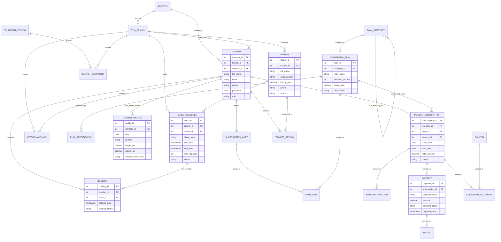

# FitTrack: Smart Gym Management System
## Deliverable 2: ER Diagram, Relational Schema & Database Mapping

### 1. Mapping QuickBasket (Demo Document) to FitTrack Entities

| Sl. No. | Demo Doc Table (QuickBasket) | FitTrack Equivalent Table | Business Function in FitTrack |
| :---: | :--- | :--- | :--- |
| 1 | `CUSTOMER` | `MEMBER` | Gym member personal records, credentials & system roles |
| 2 | `ADDRESS` | `ADDRESS` | Physical postal addresses for branches and members |
| 3 | `VENDOR` | `EQUIPMENT_VENDOR` | Suppliers supplying gym machines, supplements, and gear |
| 4 | `STORE` | `GYM_BRANCH` | Physical gym locations / fitness center facilities |
| 5 | `CATEGORY` | `PLAN_CATEGORY` | Hierarchical workout categories (Strength, Cardio, Yoga) |
| 6 | `PRODUCT` | `MEMBERSHIP_PLAN` | Membership tier packages (Gold Annual, Silver Monthly, VIP) |
| 7 | `PRODUCT_SPECIFICATION` | `PLAN_SPECIFICATION` | Semi-structured JSON specifications of plan perks |
| 8 | `INVENTORY` | `BRANCH_EQUIPMENT` | Quantity, status, and maintenance due for machines per branch |
| 9 | `CART` | `SUBSCRIPTION_CART` | Staging cart for membership and add-on personal training |
| 10 | `CART_ITEM` | `CART_ITEM` | Individual line items in member cart |
| 11 | `ORDERS` | `MEMBER_SUBSCRIPTION` | Confirmed subscription contract with date range and cost |
| 12 | `ORDER_ITEM` | `SUBSCRIPTION_ITEM` | Breakdown of base plan + personal training + locker addons |
| 13 | `PAYMENT` | `PAYMENT` | Financial transaction logs with mode (UPI/Card) & status |
| 14 | `DELIVERY_PARTNER` | `TRAINER` | Certified gym trainers, specializations, hourly charges |
| 15 | `DELIVERY` | `CLASS_SCHEDULE` | Scheduled fitness sessions (Zumba, Crossfit, Spin, HIIT) |
| 16 | `REVIEW` | `TRAINER_REVIEW` | Member ratings (1-5) and feedback for trainers and classes |
| 17 | `COUPON` | `COUPON` | Promotional vouchers offering percentage / flat fee cuts |
| 18 | `ORDER_COUPON` | `SUBSCRIPTION_COUPON` | Associative link binding discount coupons to subscriptions |
| 19 | `ORDER_STATUS_HISTORY` | `ATTENDANCE_LOG` | Time-stamped member check-in & check-out turnstile logs |
| 20 | `REFUND` | `REFUND` | Refund audit trail for cancelled plans / disputed charges |

---

### 2. Entity-Relationship (ER) Diagram (Mermaid)

---

### 3. Relational Schema Specification

Each relation is defined with primary key `[PK]` and foreign key references `[FK -> Table(Column)]`:

1. **`ADDRESS`** (
   **`address_id`** [PK],
   `street`,
   `city`,
   `state`,
   `pincode`
)
2. **`GYM_BRANCH`** (
   **`branch_id`** [PK],
   `branch_name`,
   `address_id` [FK -> ADDRESS(address_id)],
   `contact_phone`,
   `opening_time`,
   `closing_time`
)
3. **`EQUIPMENT_VENDOR`** (
   **`vendor_id`** [PK],
   `vendor_name`,
   `contact_email`,
   `contact_phone`,
   `tax_id`
)
4. **`MEMBER`** (
   **`member_id`** [PK],
   `branch_id` [FK -> GYM_BRANCH(branch_id)],
   `address_id` [FK -> ADDRESS(address_id)],
   `full_name`,
   `email` [UNIQUE],
   `phone` [UNIQUE],
   `password_hash`,
   `join_date`,
   `role` [CHECK: 'MEMBER','TRAINER','ADMIN']
)
5. **`MEMBER_PROFILE`** (
   **`profile_id`** [PK],
   `member_id` [FK -> MEMBER(member_id), UNIQUE],
   `dob`,
   `gender`,
   `height_cm`,
   `weight_kg`,
   `emergency_contact`,
   `medical_notes_json`
)
6. **`TRAINER`** (
   **`trainer_id`** [PK],
   `branch_id` [FK -> GYM_BRANCH(branch_id)],
   `full_name`,
   `email` [UNIQUE],
   `phone`,
   `specialization`,
   `hourly_rate` [CHECK >= 0],
   `availability_status` [CHECK: 'AVAILABLE','IN_SESSION','ON_LEAVE']
)
7. **`PLAN_CATEGORY`** (
   **`category_id`** [PK],
   `category_name`,
   `parent_category_id` [FK -> PLAN_CATEGORY(category_id) NULL]
)
8. **`MEMBERSHIP_PLAN`** (
   **`plan_id`** [PK],
   `category_id` [FK -> PLAN_CATEGORY(category_id)],
   `plan_name`,
   `duration_months` [CHECK > 0],
   `base_price` [CHECK >= 0],
   `description`
)
9. **`PLAN_SPECIFICATION`** (
   **`spec_id`** [PK],
   `plan_id` [FK -> MEMBERSHIP_PLAN(plan_id)],
   `specification_json`
)
10. **`BRANCH_EQUIPMENT`** (
    **`equipment_id`** [PK],
    `branch_id` [FK -> GYM_BRANCH(branch_id)],
    `vendor_id` [FK -> EQUIPMENT_VENDOR(vendor_id)],
    `equipment_name`,
    `category`,
    `quantity` [CHECK >= 0],
    `condition_status` [CHECK: 'OPERATIONAL','UNDER_MAINTENANCE','RETIRED'],
    `last_serviced_date`
)
11. **`SUBSCRIPTION_CART`** (
    **`cart_id`** [PK],
    `member_id` [FK -> MEMBER(member_id)],
    `created_at`
)
12. **`CART_ITEM`** (
    **`cart_item_id`** [PK],
    `cart_id` [FK -> SUBSCRIPTION_CART(cart_id)],
    `plan_id` [FK -> MEMBERSHIP_PLAN(plan_id)],
    `quantity` [CHECK > 0]
)
13. **`CLASS_SCHEDULE`** (
    **`class_id`** [PK],
    `branch_id` [FK -> GYM_BRANCH(branch_id)],
    `trainer_id` [FK -> TRAINER(trainer_id)],
    `class_name`,
    `start_time`,
    `end_time`,
    `max_capacity` [CHECK > 0],
    `status` [CHECK: 'SCHEDULED','IN_PROGRESS','COMPLETED','CANCELLED']
)
14. **`BOOKING`** (
    **`booking_id`** [PK],
    `member_id` [FK -> MEMBER(member_id)],
    `class_id` [FK -> CLASS_SCHEDULE(class_id)],
    `booking_date`,
    `booking_status` [CHECK: 'CONFIRMED','WAITLISTED','CANCELLED','ATTENDED']
)
15. **`MEMBER_SUBSCRIPTION`** (
    **`subscription_id`** [PK],
    `member_id` [FK -> MEMBER(member_id)],
    `plan_id` [FK -> MEMBERSHIP_PLAN(plan_id)],
    `branch_id` [FK -> GYM_BRANCH(branch_id)],
    `start_date`,
    `end_date`,
    `total_amount` [CHECK >= 0],
    `status` [CHECK: 'ACTIVE','EXPIRED','CANCELLED','PENDING']
)
16. **`SUBSCRIPTION_ITEM`** (
    **`item_id`** [PK],
    `subscription_id` [FK -> MEMBER_SUBSCRIPTION(subscription_id)],
    `item_name`,
    `quantity` [CHECK > 0],
    `unit_price` [CHECK >= 0]
)
17. **`PAYMENT`** (
    **`payment_id`** [PK],
    `subscription_id` [FK -> MEMBER_SUBSCRIPTION(subscription_id)],
    `payment_mode` [CHECK: 'UPI','CREDIT_CARD','DEBIT_CARD','CASH','NET_BANKING'],
    `amount` [CHECK > 0],
    `payment_status` [CHECK: 'SUCCESS','FAILED','PENDING'],
    `payment_date`
)
18. **`INVOICE`** (
    **`invoice_id`** [PK],
    `payment_id` [FK -> PAYMENT(payment_id)],
    `invoice_number` [UNIQUE],
    `invoice_date`,
    `tax_rate_percent`,
    `tax_amount`,
    `final_total`
)
19. **`TRAINER_REVIEW`** (
    **`review_id`** [PK],
    `member_id` [FK -> MEMBER(member_id)],
    `trainer_id` [FK -> TRAINER(trainer_id)],
    `rating` [CHECK BETWEEN 1 AND 5],
    `comments`,
    `review_date`
)
20. **`COUPON`** (
    **`coupon_id`** [PK],
    `coupon_code` [UNIQUE],
    `discount_percentage` [CHECK BETWEEN 1 AND 100],
    `min_order_amount`,
    `valid_until`
)
21. **`SUBSCRIPTION_COUPON`** (
    **`subscription_id`** [FK -> MEMBER_SUBSCRIPTION(subscription_id)],
    **`coupon_id`** [FK -> COUPON(coupon_id)],
    PRIMARY KEY (`subscription_id`, `coupon_id`)
)
22. **`ATTENDANCE_LOG`** (
    **`log_id`** [PK],
    `member_id` [FK -> MEMBER(member_id)],
    `branch_id` [FK -> GYM_BRANCH(branch_id)],
    `check_in_time`,
    `check_out_time`
)
23. **`REFUND`** (
    **`refund_id`** [PK],
    `payment_id` [FK -> PAYMENT(payment_id)],
    `refund_amount` [CHECK > 0],
    `refund_reason`,
    `refund_status` [CHECK: 'REQUESTED','PROCESSED','REJECTED'],
    `refund_date`
)

---

### 4. Normalization Analysis

- **First Normal Form (1NF)**: Every table has an established primary key. All attribute values are atomic (e.g., Address is decomposed into street, city, state, pincode; composite names into first/last or distinct atomic representations). Multi-valued dependencies are isolated into separate child tables.
- **Second Normal Form (2NF)**: The schema is in 1NF, and all non-key attributes are fully functionally dependent on the entire primary key. In associative tables with composite keys (such as `SUBSCRIPTION_COUPON`), there are no partial dependencies.
- **Third Normal Form (3NF)**: The schema is in 2NF, and no transitive dependencies exist ($X \to Y \to Z$ where $Z$ is non-prime). For example, Branch addresses are not duplicated in the `MEMBER` table; instead, foreign keys reference the canonical `ADDRESS` table.
- **Boyce-Codd Normal Form (BCNF)**: For every functional dependency $X \to Y$, $X$ is a superkey. There are no overlapping candidate keys with dependencies on non-superkeys.
