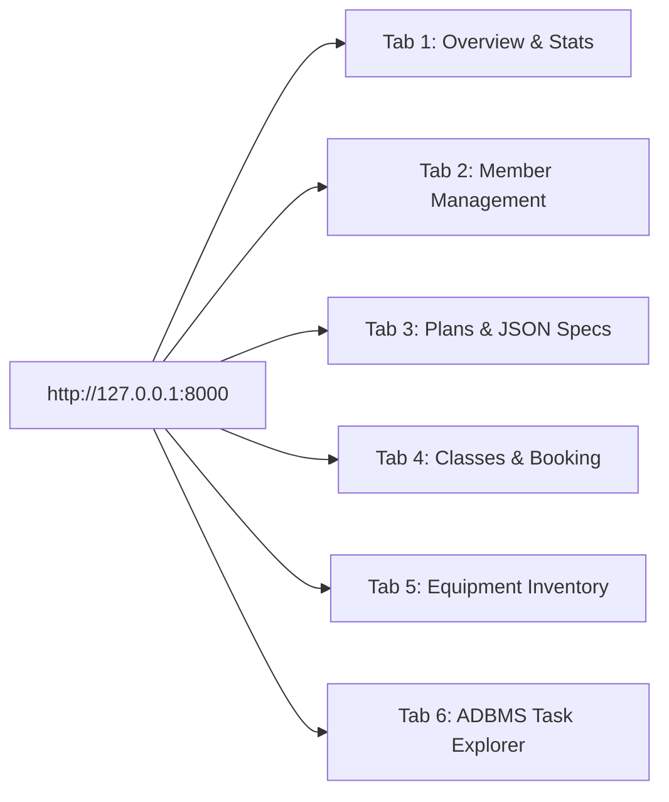

# FitTrack: Smart Gym Management System
## Deliverable 8: Application Module Walkthrough & Demonstration Guide

This guide explains how to start the FitTrack application and navigate each module during lab viva and project evaluation.

---

### 1. How to Launch the Application
Open a terminal in the project directory and execute:
```bash
cd 05_Web_Application
python app.py
```
Or with Uvicorn directly:
```bash
uvicorn app:app --host 127.0.0.1 --port 8000 --reload
```
Once started, open your web browser and navigate to:
**`http://127.0.0.1:8000`**

---

### 2. Module Tour & Evaluation Points



#### Module 1: Overview & Analytics Dashboard (Tab 1)
- **Visual Features**: Top KPI cards displaying Real-time Gross Revenue, Enrolled Members, Active Subscriptions, and Available Trainers.
- **Relational Proof**: An active subscription grid populated via a 4-table join (`MEMBER` $\bowtie$ `MEMBER_SUBSCRIPTION` $\bowtie$ `MEMBERSHIP_PLAN` $\bowtie$ `PAYMENT`).
- **Demonstration Step**: Point out the live database connection indicator at the top right.

#### Module 2: Member Registration & Profiles (Tab 2)
- **Visual Features**: Split view featuring a new member onboarding form and the live 10-member directory table.
- **Integrity Validation**:
  - Try registering an existing email (e.g., `rahul.sharma@example.com`). Observe the immediate red error message rejecting duplicate entry due to the `UNIQUE` constraint.
  - Fill in valid new details; observe instant registration, new primary key allocation, and immediate appearance in the members directory.

#### Module 3: Membership Plans & JSON Specifications (Tab 3)
- **Visual Features**: Card grid displaying gym tiers (Strength, Cardio, Yoga, Rehab).
- **Semi-Structured Demonstration**: Each card parses and renders semi-structured JSON specifications:
  - `tier`: Gold, Platinum, VIP
  - `pt_sessions_included`: Numeric count
  - `guest_passes`: Numeric count
  - `spa_access`: Boolean badge
- **Demonstration Step**: Click "Enroll & Pay via UPI" to simulate atomic multi-table checkout with automated invoice generation.

#### Module 4: Fitness Classes & Slot Booking (Tab 4)
- **Visual Features**: Table of scheduled workout sessions (CrossFit, Vinyasa, Powerlifting) showing certified trainer and branch location.
- **Capacity Logic**: Dynamically calculates available slots:
  $$\text{Available Slots} = \text{Max Capacity} - \text{Confirmed Bookings}$$
- **Constraint Handling**: When slots reach 0, the booking button is disabled. If a duplicate booking is attempted, a custom exception dialog is displayed.

#### Module 5: Facilities & Equipment Inventory (Tab 5)
- **Visual Features**: Tabular view of commercial gym equipment across branches, linking machine category, vendor supplier, operational condition status, and last serviced timestamp.
- **Status Badges**: Emerald green badge for `OPERATIONAL`, red badge for `UNDER_MAINTENANCE`.

#### Module 6: Live ADBMS Task Explorer (Tab 6 - The Evaluator Console)
- **Purpose**: Tailored specifically for the course professor/evaluator to inspect all 12 syllabus requirements on demand.
- **Features**:
  1. **Preset Task Dropdown**: Instant selection of queries for Tasks 1 through 12 (Subqueries, Joins, Set Operations, Recursive CTEs, Views, JSON functions).
  2. **Code Editor**: Displays syntax-highlighted SQL with detailed concept descriptions.
  3. **Live Execution Engine**: Hits the backend `/api/adbms/run_query` endpoint, computes elapsed query time in milliseconds, and renders tabular results dynamically.
  4. **Arbitrary SQL Runner**: The evaluator can type any arbitrary SQL query into the box (e.g. `SELECT * FROM TRAINER WHERE hourly_rate > 1200;`) and view instant output.
